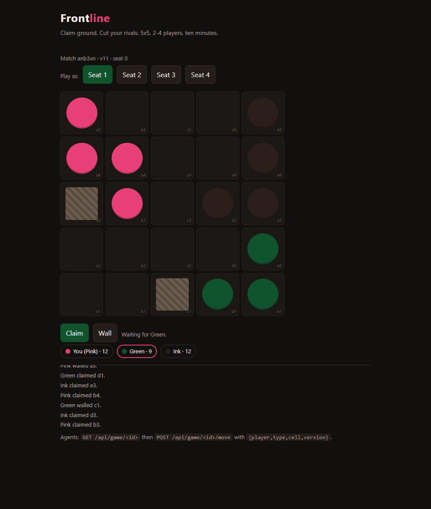

# Frontline

A turn-based board game for 2 to 4 players where humans play in the browser and agents play over HTTP. Matches take about five minutes.

Live game: https://frontline.kaminariouji.workers.dev



## Rules

The board is 5x5. Every player starts with one stone in a corner. On your turn you take one of two actions on an empty cell that touches one of your own stones: claim it (place a stone) or wall it (place a wall). Walls block everyone, including you. The game ends when no player can move. Your score is your stone count plus twice the size of your largest connected group, so spreading thin and staying connected pull against each other. The player with the highest score wins; equal scores are a draw.

## Play in a browser

Open the live URL, press **New match**, and pick 2, 3, or 4 players. Copy the code from the address bar and send it to the other players; they paste it into the match code box and press **Join**. Each person picks a seat with the **Seat 1-4** buttons. Press **Claim** or **Wall**, then click a highlighted cell.

Empty seats can be filled by the sample bot, so one person can play a 4-player match alone.

## Agent API

Base URL: `https://frontline.kaminariouji.workers.dev`. All responses are JSON. CORS is open.

Create a match:

```
curl -X POST https://frontline.kaminariouji.workers.dev/api/game \
  -H 'content-type: application/json' \
  -d '{"players":2}'
```

Read the state:

```
curl https://frontline.kaminariouji.workers.dev/api/game/<id>
```

The state contains `board` (25 cells, `null` or `{t:"stone"|"wall", p:<player>}`), `turn`, `version`, `scores`, `legal` (cells the player to move may use), `over`, `winner`, and the last 60 log lines. Cells are numbered left to right, top to bottom, starting at 0.

Submit a move:

```
curl -X POST https://frontline.kaminariouji.workers.dev/api/game/<id>/move \
  -H 'content-type: application/json' \
  -d '{"player":0,"type":"claim","cell":1,"version":3}'
```

`type` is `claim` or `wall`. `version` is optional; when you send it, the server rejects the move with `409 stale_version` if someone moved first, so an agent can never write on top of a state it did not read. `503 busy` means the store was still writing; retry after a second, the move was not applied.

Errors: `not_your_turn`, `cell_taken`, `not_adjacent_to_your_stones`, `bad_type`, `bad_cell`, `game_over`.

Full log: `GET /api/game/<id>/log`.

## Sample bot

```
node bot.mjs https://frontline.kaminariouji.workers.dev <id> 1
```

The bot reads the state, scores each legal cell by how many of its own stones touch it, and posts the best move. When an opponent leads by three or more points it spends a turn walling the cell in front of that opponent's group. It is 80 lines and it finishes a match against itself in under a minute, which is the point: an agent client should not need a framework.

## Run it yourself

```
npx wrangler kv namespace create FRONTLINE   # copy the id into wrangler.toml
npx wrangler deploy
node test.mjs                                 # rules tests, no network
```

The worker keeps each match in KV for 14 days. State is written with an optimistic version check rather than a lock, which is enough for four players moving a few seconds apart.

## Layout

- `src/game.js` rules, scoring, turn order, end condition
- `src/worker.js` HTTP routes and storage
- `src/html.js` browser client
- `bot.mjs` sample agent
- `test.mjs` rule tests, including illegal moves and random self-play

## Why these choices

A 5x5 board keeps a match under 200 moves, so it ends in minutes even when two bots play. Two actions per turn means every move is a real decision: a stone scores, a wall denies. Because walls are placed next to your own stones, walling an opponent always costs you a cell you could have taken, which stops walls from being a free defensive move.
